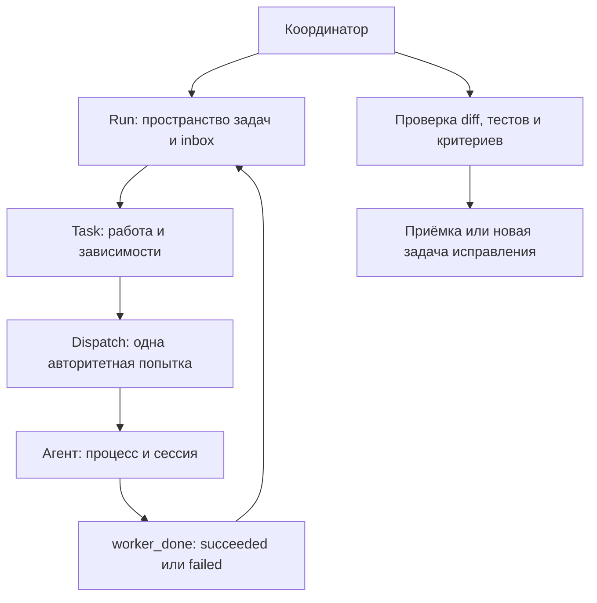

# Оркестрация агентов: OpenCode и Orca

Проверено 14 октября 2026 года в окружении puuk: **OpenCode 1.19.0**, **Orca CLI и runtime 1.4.220**. Ниже — механизмы вызова другой модели, контроль исполнения и рекомендуемый порядок приёмки.

## 1. Основной вывод

В OpenCode младшего агента другой модели проще всего определить как **subagent с собственным `model`** и вызывать через `@junior` или инструмент `task`. Orca для этого не обязательна.

Orca нужна, когда требуется координировать отдельные агентские процессы: назначать задачи, хранить попытки, получать сообщения, отслеживать зависимости и управлять ресурсами. При этом **`orca orchestration worker-start --agent opencode --model …` не поддерживается** в проверенной версии. Для OpenCode модель выбирают его конфигурацией либо собственной командой запуска `opencode --model …`, а затем привязывают готовый агент к задаче.

«Младший» — назначенная роль, а не специальный тип модели. Более дешёвую или быструю модель выбирают явно. Наличие имени в `opencode models` подтверждает доступность в каталоге конфигурации, но не успешность API-запроса и не качество работы.

| Способ | Что запускается | Где задаётся модель | Контроль |
|---|---|---|---|
| OpenCode `@junior` / `task` | Дочерняя сессия внутри OpenCode | `agent.junior.model` или frontmatter | Ответ инструмента, дочерняя сессия, проверка артефактов |
| `opencode run` | Отдельная неинтерактивная сессия | `--model provider/model` | Код процесса, JSON-события, экспорт сессии, тесты |
| Orca `terminal create` | Отдельный агент в текущем checkout | В `--command 'opencode --model …'` | Чтение терминала; само по себе без Task/Dispatch |
| Orca `worker-start` | Попытка задачи с жизненным циклом | Для OpenCode — его конфигурация; для ряда других CLI — `--model` | Task/Dispatch, inbox, completion, cleanup |
| Orca `worker-start --terminal` | Назначение задачи существующему агенту | В уже запущенном агенте | Жизненный цикл Dispatch; предсуществующий терминал может сохраняться |
| Orca handoff | Передача владения другому агенту | Через launcher или собственную команду | Подтверждение передачи, без ожидания результата |

## 2. Встроенный subagent OpenCode другой модели

### Определение агента

Пример `.opencode/agents/junior.md`:

```markdown
---
description: Выполняет небольшие самостоятельные задачи с явными критериями приёмки
mode: subagent
model: antigravity-manager/gemini-3.8-flash
permission:
  task: deny
---

Выполни только назначенную задачу. Соблюдай AGENTS.md.
Перед изменениями изучи соответствующий код и существующие изменения.
Проверь наблюдаемые критерии приёмки.
Верни: что изменено, список файлов, команды проверок и их результат,
нерешённые вопросы. Не объявляй успех, если проверки не выполнены.
```

Файл делает агента доступным только после загрузки конфигурации новой сессией/процессом. После изменения конфигурации нужно полностью перезапустить OpenCode.

Эквивалент в `opencode.json` (фрагмент нужно объединить с существующей конфигурацией):

```json
{
  "$schema": "https://opencode.ai/config.json",
  "agent": {
    "junior": {
      "description": "Выполняет небольшие задачи с явными критериями приёмки",
      "mode": "subagent",
      "model": "antigravity-manager/gemini-3.8-flash",
      "permission": { "task": "deny" },
      "prompt": "Выполни только назначенную задачу. Верни файлы, проверки, результаты и блокеры."
    }
  }
}
```

Модель в примере присутствует в локальном каталоге. Другие найденные варианты: `nyxos-claude/claude-haiku-4-5-20251001`, `nyxos-glm/glm-5.3-flash`, `nyxos-openai/gpt-6.1-sol`. Цены и сравнительная эффективность не проверялись.

Если `model` у subagent не задана, по документации OpenCode он наследует модель вызывающего основного агента. **`small_model` не выбирает модель младших агентов:** это настройка вспомогательных действий, например генерации заголовка.

Конфигурации лежат в проектном `opencode.json`/`opencode.jsonc` и глобальном `~/.config/opencode/`; агенты — в проектной `.opencode/agents/` или глобальной `~/.config/opencode/agents/`. Поддерживается также единственное число `agent/`. Проектная конфигурация переопределяет глобальную при объединении.

### Вызов

В интерфейсе:

```text
@junior Исследуй обработку ошибок в brain/<файл>. Ничего не меняй.
Верни конкретные проблемные ветки с путями и строками и способ воспроизведения.
```

Или попросить основного агента: «Передай эту задачу subagent junior, дождись результата и проверь его». Основной агент вызывает `task` с `subagent_type: "junior"`.

В доступной этой сессии схеме `task` есть `description`, `prompt`, `subagent_type`, `task_id`, `command`; **поля `model` нет**. Поэтому фраза «запусти general на Gemini» без настройки `general.model` не является надёжным способом выбора модели. Сначала нужен именованный агент с нужной конфигурацией. В текущей сессии объявлены только `general` и `explore`; документ не добавляет `junior` в работающий процесс.

При продолжении используйте возвращённый `task_id`. Новый вызов без него начинает отдельный контекст; задание должно содержать необходимые сведения, а не предполагать знание всей беседы координатора. Дочерняя сессия не создаёт отдельный Git checkout: при параллельных правках нужны непересекающиеся области владения.

Проверка доступности и настройки:

```bash
opencode models
opencode agent list
opencode debug agent junior
```

Для проверки фактически использованной модели исследуйте метаданные сообщений дочерней сессии через экспорт/ API; текстовое заявление модели о собственном имени не является доказательством. Экспорт:

```bash
opencode export <child-session-id> --sanitize
```

Список доступных сессий: `opencode session list --format json`. Дочернюю сессию можно открыть из родительской через настроенные клавиши навигации; актуальные назначения смотрите в TUI, поскольку они зависят от версии и пользовательских настроек.

### Разрешения и вложенность

`permission.task` у координатора управляет тем, каких subagent он может вызвать через инструмент:

```json
{
  "agent": {
    "build": {
      "permission": {
        "task": { "*": "deny", "junior": "allow", "reviewer": "allow" }
      }
    }
  }
}
```

Последнее совпавшее правило побеждает. В документации отмечено, что прямой вызов пользователем через `@` возможен независимо от этих ограничений на инструмент координатора. `hidden: true` скрывает агента из автодополнения, но не служит запретом вызова.

Актуальная опубликованная JSON Schema содержит `subagent_depth` с default 1: младший агент по умолчанию не запускает следующего младшего. Для роли без делегирования можно дополнительно поставить `permission.task: deny`.

`edit: deny` запрещает файловые инструменты записи; для агента только для чтения отдельно ограничьте `bash`, поскольку shell тоже может изменять файлы. Пример reviewer: `edit: deny`, `task: deny`, `bash` с `"*": "deny"` и разрешёнными `"git diff*": "allow"`, `"git status*": "allow"`. Это ограничение полномочий, не оценка корректности результата.

### Повторяемая slash-команда

Можно сохранить `.opencode/commands/junior-task.md`:

```markdown
---
description: Передать ограниченную задачу младшему агенту
agent: junior
subtask: true
---

Выполни задачу: $ARGUMENTS
Верни изменения, доказательства выполнения критериев приёмки и блокеры.
```

Вызов: `/junior-task <описание>`. `subtask: true` принудительно использует дочернюю сессию. В этом примере модель закреплена на агенте; документация также допускает `model` на самой команде.

## 3. Отдельный OpenCode без Orca

Для скрипта или отдельного исполнителя:

```bash
opencode run \
  --model antigravity-manager/gemini-3.8-flash \
  --agent build \
  --format json \
  --title 'junior: bounded task' \
  'Target: <файлы>. Change: <результат>. Constraints: <ограничения>. Ownership: <разрешённые правки>. Acceptance: <проверки>.'
```

Это самостоятельный запуск, не автоматический дочерний `task` текущего разговора. Для повторного обращения к той же сессии используйте явный `--session <id>`; `--continue` менее однозначен при параллельных запусках. `--dir` выбирает рабочий каталог, `--file` прикладывает материалы, `--attach` подключает запуск к уже работающему `opencode serve`.

Внешний координатор должен сам хранить назначение задачи, session ID, вывод, ошибки, таймауты и решение о приёмке. Код выхода и окончание ответа подтверждают состояние процесса, но не доказывают выполнение требований. В частности, недостаточно искать строку «готово» в ответе.

## 4. Orca: сущности и выбор модели



Run хранит пространство координации и inbox; сам по себе он не является планировщиком. Task описывает работу; Dispatch определяет конкретную актуальную попытку и исполнителя. Запуск готовых задач выполняет координатор. `--deps` задаёт реальные зависимости, а `task-list --ready` помогает выбрать следующую волну.

### Выбор исполняемого CLI

Порядок из skills: если задана `ORCA_CLI_COMMAND`, использовать её; иначе при `ORCA_DEV_REPO_ROOT` — `orca-dev`; на Linux вне управляемого терминала — `orca-ide`; внутри Orca — `orca`. В этой сессии `orca` разрешается в `/home/fish/.config/orca/linux-orca-cli-shim/orca` и успешно обращается к runtime. Вне такого окружения голый `/usr/bin/orca` может оказаться экранным диктором GNOME.

До запуска читать гайд именно установленной версии:

```bash
orca status --json
orca skills get orchestration
orca skills get orchestration --reference references/coordinator-loop.md
orca orchestration worker-start --help
```

Примеры ниже предполагают управляемый терминал с рабочим shim `orca`.

### Обычный OpenCode worker

```bash
orca orchestration run-create --objective '<общая цель>' --json
orca orchestration worker-start \
  --spec '<полная спецификация задачи>' \
  --worktree current --agent opencode --json
```

Такой worker использует выбор модели OpenCode из его конфигурации. Модель текущего координатора не следует считать автоматически переданной новому процессу. `--agent opencode` здесь обозначает программу launcher Orca; `--agent junior` в OpenCode обозначает роль внутри программы. Это разные пространства имён.

`worker-start --model` поддерживается для Claude, Codex, Cursor, Antigravity и Muse; `--effort` требует `--model` и поддержки выбранной моделью. Эти параметры нельзя сочетать с `--terminal`. Сравнивать нужно `launch.requested` и `launch.effective`, а не только аргументы команды. Каталог моделей OpenCode с `nyxos-*` не доказывает доступность тех же моделей в Codex/Claude CLI.

### OpenCode worker с другой моделью через собственный запуск

Когда нужен per-call выбор модели OpenCode, используйте готовый терминал:

```bash
orca orchestration run-create --objective '<общая цель>' --json
orca terminal create \
  --worktree current \
  --title 'junior-gemini' \
  --command 'opencode --model antigravity-manager/gemini-3.8-flash --agent build' \
  --json
orca terminal wait --terminal <handle> --for tui-idle --timeout-ms 60000 --json
orca orchestration worker-start \
  --spec '<полная спецификация задачи>' \
  --worktree current --terminal <handle> --json
```

Каждый следующий шаг зависит от успешного предыдущего. `<handle>` копируется из результата создания терминала. Продолжать после wait можно только при `satisfied: true`; истечение ожидания не является готовностью. `worker-start --terminal` назначает задачу уже работающему агенту и отвечает за Dispatch, но предсуществующий терминал может быть сохранён при release согласно правилам ownership. Это следует отражать в итоговом отчёте.

Если нужен отдельный checkout, сначала создать его средствами Orca и использовать точный selector из результата вместо `current`. `current` разделяет файлы с координатором; новый checkout изолирует изменения. Рабочие незакоммиченные изменения текущего каталога нельзя предполагать перенесёнными в новый checkout. Для общего кода нужны явно выбранная база и стратегия переноса результата.

Низкоуровневый вариант — `task-create`, затем `dispatch --task <id> --to <handle> --inject`. Он создаёт авторитетный контекст Task/Dispatch, но **не создаёт supervised worker resource row**. В этой полосе `worker-stop`/`worker-release` не управляют процессом. Использовать её следует при необходимом собственном argv/топологии; для владения жизненным циклом существующего терминала гайд рекомендует `worker-start --terminal`.

### Передача владения без контроля результата

Orca handoff через `worktree create --agent … --prompt …` или `terminal send` завершает работу передающего после подтверждённой передачи. Если требуется дождаться и проверить результат, нужен supervised loop. Выбор модели сам по себе не превращает handoff в supervised работу.

## 5. Как проверяются задачи

Нужно различать **доставку**, **жизненный цикл попытки** и **качество работы**.

| Свидетельство | Что подтверждает | Чего не подтверждает |
|---|---|---|
| `accepted: true`, `input_accepted` | Ввод принят | Что агент начал или завершил задачу |
| `turn_started` | Начало хода доказано | Выполнение требований |
| heartbeat / `live` | Наблюдаемая активность или живой агент | Успех |
| TUI idle | Готовность/простой интерфейса | Приёмку задачи |
| Принятый `worker_done` | Авторитетное завершение попытки с явным outcome | Независимую проверку кода |
| diff + воспроизводимые проверки + acceptance | Соответствие проверяемым требованиям | Всё, что проверки не покрывают |

### Контракт задачи

Самодостаточная спецификация должна включать:

```text
Target: точные файлы/компонент/окружение.
Change: конкретный требуемый результат.
Constraints: инварианты, совместимость и границы изменений.
Ownership: разрешённые файлы и взаимодействие с другими исполнителями.
Observable acceptance: команды, сценарии и артефакты, доказывающие результат.
Report: файлы, команды, результаты, оставшиеся блокеры.
```

Для puuk: тесты БД должны быть изолированы через `PUUK_DB_PATH`; оригинальные аудиофайлы не изменяются. В задаче указывать точные команды выбранного компонента после изучения его конфигурации, а не поручать абстрактное «проверь всё».

### Кто что проверяет

1. **Worker** выполняет работу и локальные проверки, сообщает факты и явный outcome.
2. **Orca runtime** проверяет полномочия жизненного цикла: актуальный Task/Dispatch, соответствие исполнителю, capability из live preamble и допустимость settlement. Принятый `worker_done` сам завершает Task и Dispatch; дополнительный `task-update --status completed` не нужен.
3. **Координатор** сопоставляет ответ с назначенной попыткой, читает реальные изменения, проверяет каждый acceptance-критерий и при необходимости запускает независимые проверки.
4. **Reviewer другой модели**, если нужен, исследует конкретный diff/артефакт и воспроизводимость результатов. Согласие двух моделей не заменяет выполнение проверок.

В изученном контракте нет гарантии автоматического запуска тестов или смысловой оценки результата Orca. `worker_done --outcome succeeded` остаётся заявлением исполнителя, прошедшим проверку авторитетности отправителя. Для воспроизводимого контроля качества создайте отдельную Task приёмки с зависимостью от реализации. Исправления после неуспешной приёмки — новая задача; не нужно переписывать историю уже завершённой попытки.

### Цикл координатора

Начать всю независимую волну до ожидания. Затем:

```bash
orca orchestration check \
  --wait --types 'worker_done,escalation,question' --timeout-ms 60000 --json
orca orchestration worker-show --dispatch <dispatch-id> --json
orca orchestration worker-read --dispatch <dispatch-id> --limit 50 --json
orca orchestration worker-list --run <run-id> --include-remote --json
```

Обработать весь FIFO batch Delivery, а не только нужный тип сообщения. Ответить на вопросы через `reply --id <message-id> --body '<ответ>' --json`. Прочитать отчёт/изменения, сопоставить критерии. После принятого settlement выбрать reuse, release либо явно запрошенное пользователем retain. Затем подтвердить обработку:

```bash
orca orchestration worker-release --dispatch <dispatch-id> --json
orca orchestration check --ack <delivery-id> --json
```

При reuse запускают следующую задачу на доказанном handle через `worker-start --terminal`; при этом явно указывают worktree этого терминала. `check` без ack повторяет уже выданный batch. `--peek` — просмотр, не продвижение inbox. Завершение координатора: все ожидаемые попытки имеют outcome, все сообщения обработаны, у каждого settled worker принято решение о ресурсе.

Отсутствие результата или таймаут — checkpoint. После трёх пустых ожиданий перейти к `worker-list`, проверить `projection.liveness`, `projection.attention` и буквальный `projection.nextAction.argv`. Fleet liveness и живой PTY — разные уровни. `unverifiable` не доказывает смерть процесса и не разрешает автоматически создавать дублирующего исполнителя. Для восстановления читать `references/recovery-and-cleanup.md`; повторять неясную мутацию только с её operation identity `--retry-request`, а не вслепую.

У worker completion-команда должна быть скопирована из **его live injected preamble**, включая Task/Dispatch, отправителя и capability. Worker отправляет `worker_done` один раз из назначенного контекста, с `--outcome succeeded` или `failed`; после этого заканчивает ход. До completion он читает follow-up inbox, вопросы координатору отправляет через предусмотренный `ask`.

## 6. Устаревшие обходы и актуальная памятка

[ORCHESTRATION.md](ORCHESTRATION.md) переписана как актуальная практическая памятка. В её прежней редакции были исторические обходы запуска OpenCode, которые не соответствуют текущему контракту Orca 1.4.220:

- **Автоматически досылать spec через 20–30 секунд тишины нельзя.** Современный send различает `input_accepted` и `turn_started`; тишина не доказывает потерю ввода. Сначала исследовать receipt, состояние и output; при неясном транспортном результате использовать предусмотренный `--retry-request`.
- **Восстанавливать capability из истории и отправлять completion координатором от имени worker не является рекомендуемым recovery.** Текущий гайд связывает authority с live Dispatch и назначенным контекстом. Следовать recovery receipt и гайду установленной версии; не изображать сообщение исполнителя.
- **«Всегда opencode, codex не установлен» — историческая характеристика машины.** При этой проверке наличие/авторизация Codex не исследовались; использовать её как постоянный факт нельзя.
- **`worker-release` не гарантирует закрытие любого терминала.** Предсуществующие, переиспользованные и перешедшие пользователю терминалы могут сохраняться.
- Kernel и recovery reference расходятся в описании default scope `worker-list`. Поэтому в воспроизводимых командах этого документа везде, где известен Run, указывается `--run <run-id>`.

## 7. Что действительно проверено

Проведена проверка документации, CLI и разрешения конфигурации; рабочие задачи агентам в рамках исследования не отправлялись.

- `opencode --version`: 1.19.0.
- `orca --version` и `orca status --json`: 1.4.220, runtime ready/reachable.
- `opencode models`: подтверждены приведённые локальные ID моделей.
- `opencode agent list`: пользовательских `junior`/`reviewer` сейчас нет; встроены в том числе `general` и `explore`.
- Через временный `OPENCODE_CONFIG_CONTENT` и `opencode debug agent junior` проверялось, что JSON-определение с `mode: subagent`, `model: antigravity-manager/gemini-3.8-flash`, `permission.task: deny` принимается. Перед использованием проверьте модель в локальном `opencode models` и фактически разрешённую модель через `opencode debug agent junior`.
- Прочитаны актуальная JSON Schema и справка `run`, `debug`, `export`, `worker-start`, `worker-show`, `dispatch`, `task-create`, `send`.
- Загружены version-matched guides Orca и references `coordinator-loop`, `low-level-topology`, `recovery-and-cleanup`, `messaging-and-gates`.

Не выполнялись API-запросы выбранной младшей модели, end-to-end запуск worker и приёмка реальной задачи. Команды запуска — основанные на проверенной справке рецепты, не отчёт о прошедшем smoke test. Постоянная конфигурация OpenCode и существующие задачи Orca не менялись.

## 8. Источники

- [OpenCode: agents](https://opencode.ai/docs/agents/) — модель агента, наследование, режимы, permissions.
- [OpenCode: commands](https://opencode.ai/docs/commands/) — slash-команды, `subtask`, выбор агента/модели.
- [OpenCode: CLI](https://opencode.ai/docs/cli/) — отдельный запуск и экспорт сессий.
- [OpenCode: JSON Schema](https://opencode.ai/config.json) — допустимые поля и `subagent_depth`.
- `orca skills get orchestration` и `orca skills get orca-cli` — контракт установленного runtime.
- `orca skills get orchestration --reference references/coordinator-loop.md` — model/effort, ready waves, reuse.
- `orca skills get orchestration --reference references/low-level-topology.md` — custom argv, unsupervised dispatch.
- `orca skills get orchestration --reference references/recovery-and-cleanup.md` — доказательства, retries, cleanup.
- `orca skills get orchestration --reference references/messaging-and-gates.md` — Delivery/ack, вопросы и gates.

При обновлении сначала повторно читать справку установленной версии: публичная документация и локальные binaries обновляются независимо.
